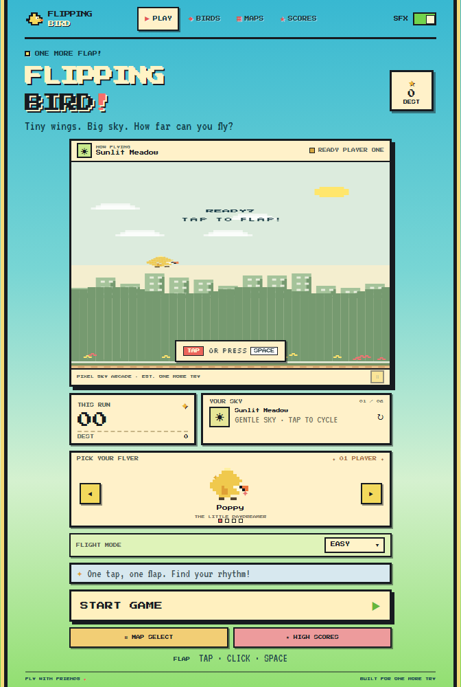
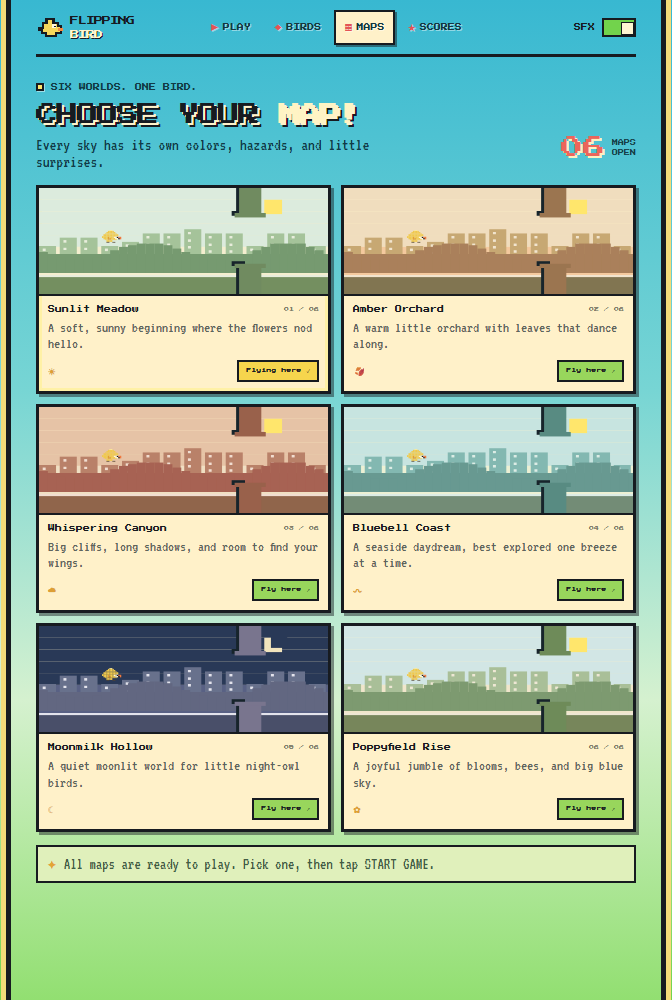
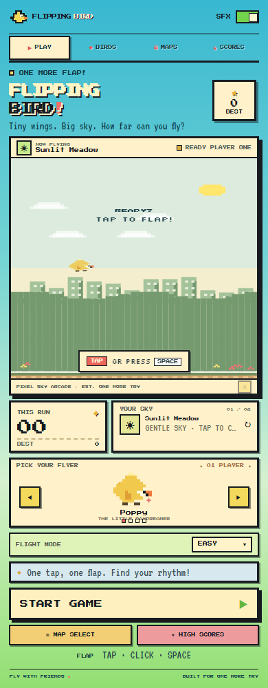

<div align="center">
  <h1>Flipping Bird</h1>
  <p><strong>A tiny pixel bird, six skies, and always one more try.</strong></p>
  <p>A hand-crafted, browser-first arcade game with original pixel scenes, quick controls, and a little flock of birds.</p>
  <p>
    
    
    
    
  </p>
  
  <p><em>Choose a bird. Pick a sky. See how far you can fly.</em></p>
</div>

## Six maps

Each map has its own palette and scenery. All six are open from the start.

| Map | Sky |
| --- | --- |
| Sunlit Meadow | A soft green beginning |
| Amber Orchard | Warm autumn colors |
| Whispering Canyon | Rust-red cliffs |
| Bluebell Coast | Sea-glass blues |
| Moonmilk Hollow | A quiet, starry night |
| Poppyfield Rise | Bright wildflower fields |

<div align="center">
  
</div>

## Play

Tap or click the game, or press **Space** / **↑** to flap. Use **P** or **Esc** to pause. Fly between the gates to build your score.

Pick from four birds, cycle between Easy, Normal, and Hard, turn sound effects on or off, and check your personal bests and flight log. Progress is saved in your browser.

<div align="center">
  
</div>

## Run locally

No dependencies or build step are needed. Open `index.html`, or start a local server:

```sh
python -m http.server 8000
```

Then open `http://localhost:8000` in a browser. The game supports mouse, touch, and keyboard input.

## Files

```text
.
├── app.js
├── index.html
├── style.css
└── screenshots/
    ├── flight-desktop.png
    ├── flight-mobile.png
    └── worlds-desktop.png
```

## License

Released under the [MIT License](LICENSE).
